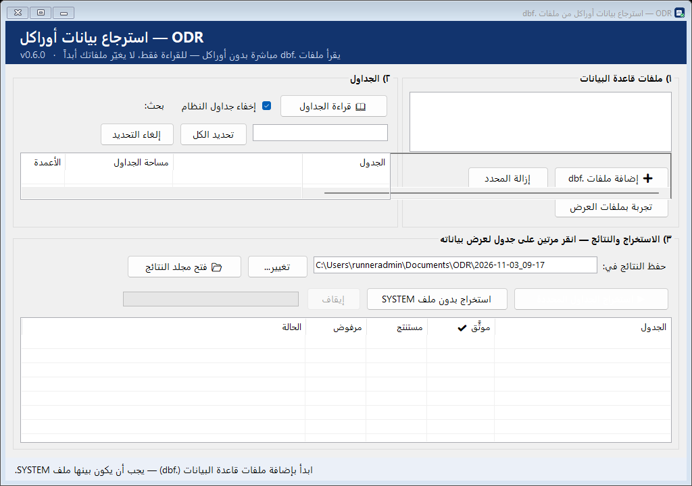
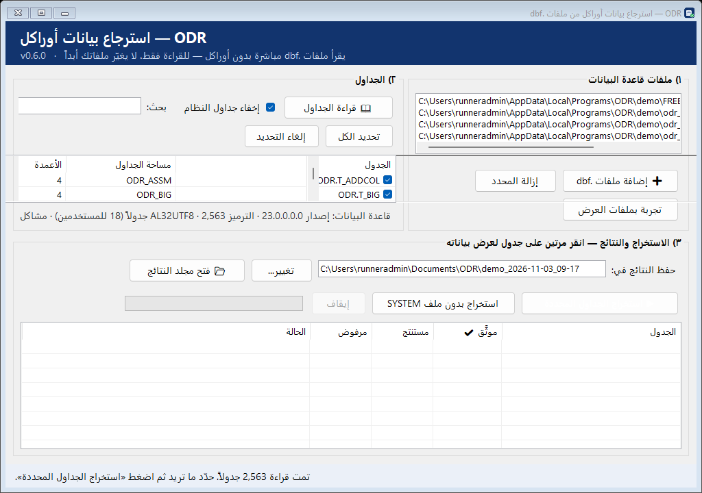
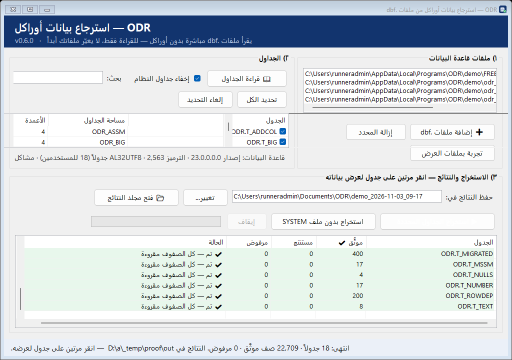
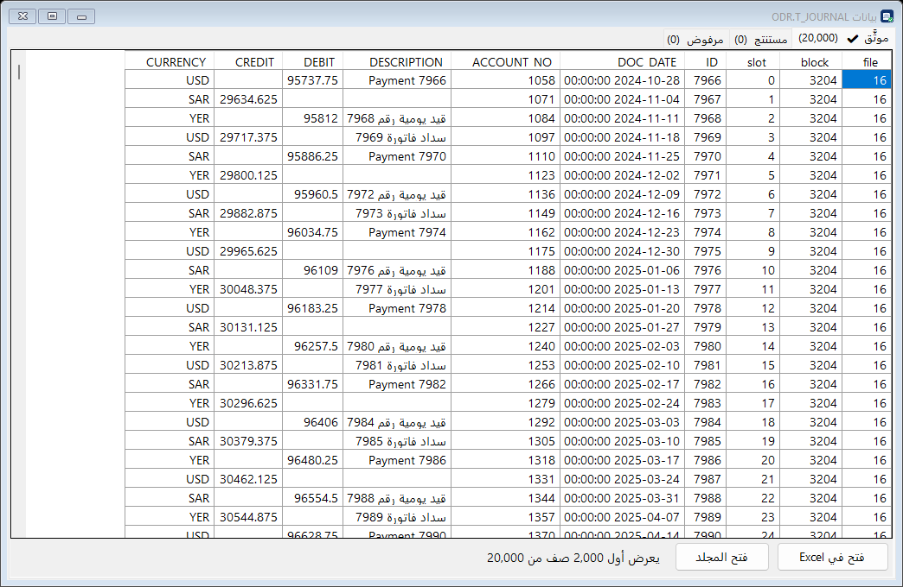

# تطبيق ODR لويندوز — الإثبات

**ما هو:** برنامج بنافذة عربية وأزرار (لا أوامر). مثبّت واحد: `ODR-Setup-0.6.0.exe` (35 MB).

## الإثبات على جهاز ويندوز حقيقي (GitHub Actions، 2026-11-03، التشغيل 41609335736)
1. بُني المحرك والتطبيق والمثبّت ووُقّعت كلها (شهادة ODR، بصمة `BB1A79CC9C7820DCE331369270B8E46149550FFA`، ختم زمني DigiCert).
2. ثُبّت البرنامج بصمت: `Installation process succeeded` (install.log)، واختصار قائمة ابدأ موجود.
3. شُغّل البرنامج **المثبَّت** وقاد نافذته بنفسه: **14 من 14 فحصاً ناجحاً** (`autotest.txt`):
   - 4 ملفات عرض، قراءة 18 جدولاً، 0 مشاكل قاموس
   - استخراج 18 جدولاً كلها سليمة؛ T_JOURNAL 20,000 موثَّق؛ LOB 6+6؛ COMPRESS 2,000؛ النص العربي صحيح
4. أُلغي التثبيت ونُظّف المجلد.

البصمة (SHA-256) للمثبّت: `94a81623d0287665e04ec81b4e1da726246f0b871c9b87dcbaf80e23ac22d085`

## اللقطات
| | |
|---|---|
| البداية |  |
| الجداول |  |
| النتائج: 18 جدولاً، 22,709 صف موثَّق، 0 مرفوض |  |
| عرض البيانات العربية |  |

## كيف يجرّبه أي شخص
1. شغّل `ODR-Setup-0.6.0.exe` ← «التالي» ← «تثبيت» (لا يحتاج صلاحيات مدير). إن ظهر تحذير SmartScreen: More info ← Run anyway.
2. افتح «ODR - استرجاع بيانات أوراكل» من قائمة ابدأ.
3. زر «تجربة بملفات العرض» ← «قراءة الجداول» ← «استخراج الجداول المحددة».
4. على ملفاته: «إضافة ملفات .dbf» (SYSTEM + ملفات الجداول) ثم نفس الخطوات.

التحديث: تشغيل مثبّت أحدث فوق القديم. الإزالة: الإعدادات ← التطبيقات ← ODR.
